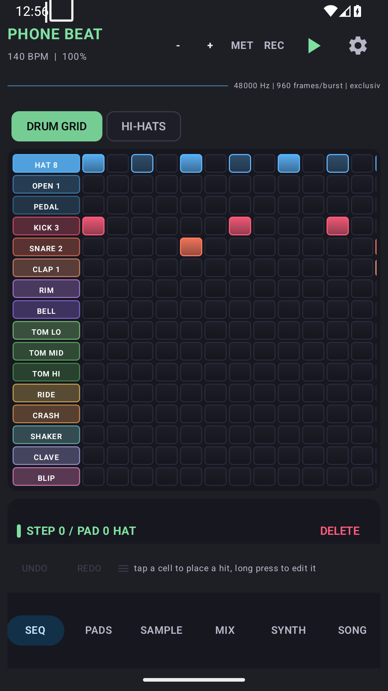

# NC Phone Beat

A 16-pad MPC for Android, built in Raleigh, NC. The beta is free; from
December 1, 2026 each app is $5 once.

[Download the latest beta APK](https://github.com/ncsound919/nc-phone-beat/releases/latest/download/NC-Phone-Beat-beta.apk) ·
[Manual](https://ncsound-hub.vercel.app/manuals/phone-beat) ·
[Changelog](https://ncsound-hub.vercel.app/changelogs/phone-beat) ·
[App page](https://ncsound-hub.vercel.app/apps/phone-beat)

## What it is

Phone Beat is the drum machine in the NC Sound set. A native C++17 engine
handles sample playback and synthesis with no allocation, locks or logging on
the audio thread. The Kotlin layer owns the pattern, the undo stack and the
project file.

- **16 pads across four banks**, switchable while the pattern runs.
- **Step grid up to 64 steps**, with per-step velocity, ratchet (1–8),
  probability, nudge and swing. Bulk humanize, velocity scale, quantize and
  rotate are one undo step each.
- **Pad Perform and 16 Levels** for playing the kit chromatically or spreading
  one sound across the grid.
- **Sample editor** with waveform slicing, WAV import, mic capture, normalize,
  fades, reverse and per-pad filter/envelope.
- **Four synths** — sub 808, rompler, Juno-style DCO and DX7-style FM.
- **Mix and FX** — per-track gain, pan, mute/solo, shared drive/chorus/delay/
  reverb/shimmer chain and master limiting.
- **Export** — individual WAV stems or a `.ncbeat` package that opens in
  [NC Studio](https://github.com/ncsound919/NC-Studio) with pads mapped to tracks.

## Install the beta

1. Download the APK on an **Android 9.0+** phone.
2. Open the file. Android will ask you to allow installs from your browser or
   file manager for this one install.
3. **Uninstall any older debug build first.** The beta uses the Android debug
   signing key, so it will not install over a differently signed copy.
4. Play Protect may warn because this is a direct beta build, not a Play Store
   release. That warning is expected.

The current beta is **0.3.0** (`versionCode` 3), about 62 MB, debug-signed.
Requires Android 9.0 (API 28) or newer.

## Known limits

- An audio-route change closes the stream; the engine rebuilds on the next
  launch. Use wired output and avoid switching output while recording.
- MIDI input is not wired yet.
- WAV import is PCM16/float32 only, with a 10 s cap per pad.
- Stem export is a fixed 4 s render per track.
- Song mode chains patterns but does not render a full arrangement.
- The app is designed for portrait.

## Licence and pricing

The beta is free to install and use. From **December 1, 2026**, each app is
**$5 once** — no subscription. Members pay **$3**; invitees pay **$2**. A
licence covers the named app on devices you own and includes its updates.

This repository distributes public beta builds only. The application source is
private. Please do not redistribute modified builds.

## Support

Email [tap4500@gmail.com](mailto:tap4500@gmail.com) with the app version, phone
model and Android version. Bugs and install reports are welcome in
[Issues](https://github.com/ncsound919/nc-phone-beat/issues).
